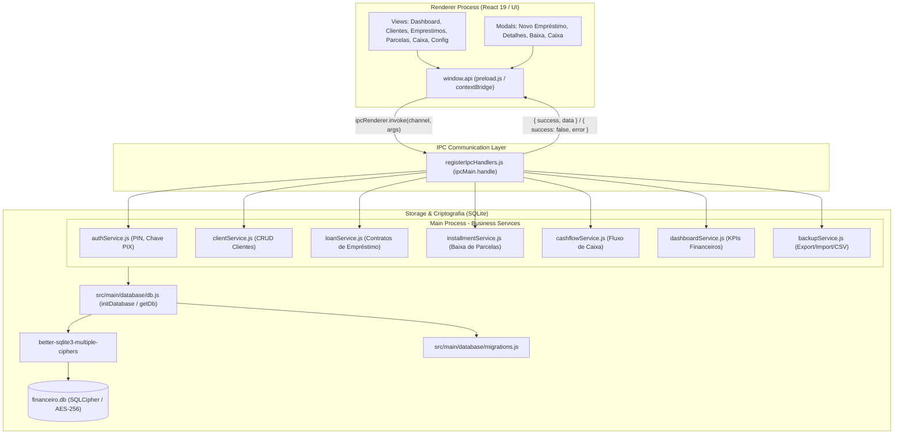

# Documento Técnico de Arquitetura — Ca$hManager (Desktop)

**Versão da Aplicação:** 1.0.0  
**Stack Principal:** Electron 42.x, Node.js, React 19, SQLite3 com SQLCipher (`better-sqlite3-multiple-ciphers`), TailwindCSS, Vite.  
**Público-Alvo:** Agentes Autônomos de IA e Engenheiros de Software Sênior.  
**Objetivo do Documento:** Servir como especificação técnica canônica e detalhada do sistema, cobrindo o estado atual da base de código e fornecendo os blueprints de engenharia para:
1. Correção de caminho de inicialização do banco de dados (erro de `mkdirSync` no `app.asar`);
2. Sistema resiliente de migrações com snapshot de backup e rollback automático;
3. Implementação da funcionalidade de **Pagamento Parcial de Empréstimos e Parcelas**.

---

## 1. Visão Geral da Arquitetura do Sistema

O **Ca$hManager** é uma aplicação desktop baseada em arquitetura Electron desacoplada em três camadas:
1. **Processo Principal (Main Process):** `src/main/main.js`, orquestrador do ciclo de vida, janelas nativas, auto-atualização e ponte IPC.
2. **Camada de Dados & Regras de Negócio (Services & DB):** `src/main/database/` e `src/main/services/`, executando exclusivamente em Node.js no Main Process com banco embarcado SQLite criptografado via `better-sqlite3-multiple-ciphers`.
3. **Processo de Renderização (Renderer Process):** SPA em React 19 empacotada via Vite em `dist/renderer/`, comunicando-se estritamente via `contextBridge` (`src/main/preload.js`) e canais IPC bidirecionais assíncronos (`ipcRenderer.invoke` <-> `ipcMain.handle`).



---

## 2. Banco de Dados e Criptografia (`src/main/database/db.js`)

### 2.1 Como o Banco é Inicializado e Trecho Exato de Código

O arquivo central de conexão é `src/main/database/db.js`. A inicialização ocorre através da função `initDatabase(customPath = null)`, invocada no startup em `src/main/main.js` (linha 103) dentro de `app.whenReady()`.

Trecho de código exato (`src/main/database/db.js`, linhas 20-67):

```javascript
/**
 * Inicializa a conexão com o banco de dados SQLite com criptografia
 * @param {string} [customPath] Caminho customizado para o arquivo de banco
 * @returns {Database.Database}
 */
function initDatabase(customPath = null) {
  if (dbInstance && (!customPath || customPath === currentDbPath)) {
    return dbInstance;
  }

  if (dbInstance) {
    dbInstance.close();
    dbInstance = null;
  }

  let dbPath = customPath;
  if (!dbPath) {
    const isDev = !require('electron').app.isPackaged;
    const baseDir = isDev 
      ? path.join(__dirname, '../../../data')
      : path.join(require('electron').app.getPath('userData'), 'data');

    if (!fs.existsSync(baseDir)) {
      fs.mkdirSync(baseDir, { recursive: true });
    }
    dbPath = path.join(baseDir, 'financeiro.db');
  } else {
    const dir = path.dirname(dbPath);
    if (!fs.existsSync(dir)) {
      fs.mkdirSync(dir, { recursive: true });
    }
  }

  currentDbPath = dbPath;

  const db = new Database(dbPath, {
    verbose: process.env.DB_DEBUG === 'true' ? console.log : null
  });

  // Configuração de Criptografia SQLCipher / multiple-ciphers
  const encryptionKey = getEncryptionKey();
  if (encryptionKey) {
    db.pragma(`key = '${encryptionKey.replace(/'/g, "''")}'`);
  }

  // Pragmas de performance, integridade e integridade referencial
  db.pragma('foreign_keys = ON');
  db.pragma('journal_mode = WAL');
  db.pragma('synchronous = NORMAL');

  dbInstance = db;
  return dbInstance;
}
```

### 2.2 Diagnóstico do Erro `mkdirSync` no `app.asar`

> [!CAUTION]
> **Causa Raiz do Bug ao Compilar/Executar:**
> 1. Na linha 34: `path.join(__dirname, '../../../data')` assume a hierarquia do sistema de arquivos de desenvolvimento (`src/main/database` -> sobe 3 níveis -> pasta raiz `data/`).
> 2. Quando o Electron compila a aplicação com o **Electron Builder**, os arquivos de script são empacotados dentro do arquivo virtual somente-leitura `resources/app.asar`.
> 3. Se a variável `isDev` for avaliada como `true` indevidamente (por exemplo: falta da variável de ambiente `NODE_ENV=production`, chamada precoce antes da hidratação completa do objeto `app`, ou execução sob certos launchers de teste), o código tenta resolver `path.join(__dirname, '../../../data')` a partir de `resources/app.asar/src/main/database`, resultando em:  
>    `C:\...\resources\app.asar\data`
> 4. O ASAR é um arquivo compactado somente-leitura. O comando `fs.mkdirSync(baseDir, { recursive: true })` tenta criar uma pasta física dentro do arquivo `.asar`, resultando imediatamente em:  
>    `Error: EROFS: read-only file system, mkdir '...resources\app.asar\data'` ou `Error: EACCES / ENOTDIR`.
> 5. Além disso, mesmo em modo de produção (`isDev = false`), criar subpastas desnecessárias como `userData/data` pode falhar dependendo dos privilégios de instalação do usuário no Windows.

### 2.3 Como a biblioteca `better-sqlite3-multiple-ciphers` é Usada e Injeção de `PRAGMA key`

A biblioteca `better-sqlite3-multiple-ciphers` (versão `12.6.2`) é um fork binário C++ nativo do `better-sqlite3` que inclui suporte a algoritmos de criptografia como SQLCipher 4, ChaCha20, wxSQLite3 e AES-256-CBC.

1. **Instanciação:**  
   `const db = new Database(dbPath, { verbose: ... });`
2. **Obtenção da Chave de Criptografia:**  
   `src/main/database/db.js` (linhas 11-13):
   ```javascript
   function getEncryptionKey() {
     return process.env.DB_ENCRYPTION_KEY || 'app-financeiro-default-key-v1';
   }
   ```
3. **Injeção da Chave via PRAGMA:**  
   A chave deve ser enviada **obrigatoriamente na primeira instrução** executada na conexão antes de qualquer leitura ou escrita:
   ```javascript
   const encryptionKey = getEncryptionKey();
   if (encryptionKey) {
     db.pragma(`key = '${encryptionKey.replace(/'/g, "''")}'`);
   }
   ```
4. **Configurações Adicionais de Conexão:**
   - `PRAGMA foreign_keys = ON;` — Ativação obrigatória da integridade referencial do SQLite (por padrão vem desligada).
   - `PRAGMA journal_mode = WAL;` — Write-Ahead Logging para concorrência de leitura sem lock.
   - `PRAGMA synchronous = NORMAL;` — Redução de I/O em disco mantendo atomicidade no modo WAL.

---

## 3. Schema e Tabelas do Banco de Dados (`src/main/database/migrations.js`)

Todas as tabelas são gerenciadas via migrations versionadas. Atualmente existe a migration `version: 1` (`initial_schema`).

### 3.1 DDL Completo das Tabelas

#### 1. Tabela `_migrations` (Controle do Versionador)
```sql
CREATE TABLE IF NOT EXISTS _migrations (
  version INTEGER PRIMARY KEY,
  name TEXT NOT NULL,
  applied_at TEXT DEFAULT CURRENT_TIMESTAMP
);
```

#### 2. Tabela `configuracoes` (Singleton de Configurações do Sistema)
Armazena a chave PIX, o hash Bcrypt do PIN de segurança e a versão. Garante linha única com `CHECK (id = 1)`.
```sql
CREATE TABLE IF NOT EXISTS configuracoes (
  id INTEGER PRIMARY KEY CHECK (id = 1),
  pin_hash TEXT,
  chave_pix TEXT,
  versao_sistema TEXT DEFAULT '1.0.0',
  criado_em TEXT DEFAULT CURRENT_TIMESTAMP,
  atualizado_em TEXT DEFAULT CURRENT_TIMESTAMP
);
```
*Registro padrão inserido:* `(id = 1, versao_sistema = '1.0.0')`.

#### 3. Tabela `clientes` (Cadastro de Tomadores)
```sql
CREATE TABLE IF NOT EXISTS clientes (
  id INTEGER PRIMARY KEY AUTOINCREMENT,
  nome TEXT NOT NULL,
  cpf TEXT UNIQUE,
  telefone TEXT,
  endereco TEXT,
  status TEXT DEFAULT 'ativo',
  criado_em TEXT DEFAULT CURRENT_TIMESTAMP
);

CREATE INDEX IF NOT EXISTS idx_clientes_nome ON clientes(nome);
CREATE INDEX IF NOT EXISTS idx_clientes_cpf ON clientes(cpf);
CREATE INDEX IF NOT EXISTS idx_clientes_status ON clientes(status);
```

#### 4. Tabela `emprestimos` (Contratos Financeiros)
```sql
CREATE TABLE IF NOT EXISTS emprestimos (
  id INTEGER PRIMARY KEY AUTOINCREMENT,
  cliente_id INTEGER NOT NULL,
  valor_investido REAL NOT NULL CHECK (valor_investido > 0),
  taxa_juros REAL NOT NULL CHECK (taxa_juros >= 0),
  parcelas INTEGER NOT NULL CHECK (parcelas > 0),
  frequencia TEXT NOT NULL CHECK (frequencia IN ('diario', 'semanal', 'quinzenal', 'mensal')),
  data_inicio TEXT NOT NULL,
  status TEXT DEFAULT 'ativo' CHECK (status IN ('ativo', 'quitado', 'cancelado')),
  criado_em TEXT DEFAULT CURRENT_TIMESTAMP,
  FOREIGN KEY (cliente_id) REFERENCES clientes(id) ON DELETE RESTRICT
);

CREATE INDEX IF NOT EXISTS idx_emprestimos_cliente ON emprestimos(cliente_id);
CREATE INDEX IF NOT EXISTS idx_emprestimos_status ON emprestimos(status);
```

#### 5. Tabela `parcelas` (Cronograma de Amortização das Parcelas)
```sql
CREATE TABLE IF NOT EXISTS parcelas (
  id INTEGER PRIMARY KEY AUTOINCREMENT,
  emprestimo_id INTEGER NOT NULL,
  numero_parcela INTEGER NOT NULL,
  valor REAL NOT NULL CHECK (valor >= 0),
  data_vencimento TEXT NOT NULL,
  data_pagamento TEXT,
  status TEXT DEFAULT 'pendente' CHECK (status IN ('pendente', 'pago', 'atrasada', 'cancelada')),
  criado_em TEXT DEFAULT CURRENT_TIMESTAMP,
  FOREIGN KEY (emprestimo_id) REFERENCES emprestimos(id) ON DELETE CASCADE
);

CREATE INDEX IF NOT EXISTS idx_parcelas_emprestimo ON parcelas(emprestimo_id);
CREATE INDEX IF NOT EXISTS idx_parcelas_vencimento ON parcelas(data_vencimento);
CREATE INDEX IF NOT EXISTS idx_parcelas_status ON parcelas(status);
```

#### 6. Tabela `movimentacoes_caixa` (Livro Caixa / Fluxo Financeiro)
```sql
CREATE TABLE IF NOT EXISTS movimentacoes_caixa (
  id INTEGER PRIMARY KEY AUTOINCREMENT,
  tipo TEXT NOT NULL CHECK (tipo IN ('entrada', 'saida')),
  valor REAL NOT NULL CHECK (valor > 0),
  descricao TEXT NOT NULL,
  data TEXT NOT NULL,
  origem_id INTEGER,
  criado_em TEXT DEFAULT CURRENT_TIMESTAMP
);

CREATE INDEX IF NOT EXISTS idx_movimentacoes_data ON movimentacoes_caixa(data);
CREATE INDEX IF NOT EXISTS idx_movimentacoes_tipo ON movimentacoes_caixa(tipo);
```

---

## 4. Fluxo de Negócio Atual (Quitação e Baixa de Parcelas)

### 4.1 Rastreamento Completo da Execução

No código atual **não existe uma função isolada chamada `quitarEmprestimo`**.  
A quitação de um empréstimo é uma **consequência reativa** da liquidação da última parcela pendente via `darBaixaParcela()`.

O ciclo de vida funciona assim:
1. O usuário clica em "Dar Baixa" em uma parcela na tela de Parcelas ou no modal de Detalhes do Empréstimo.
2. A UI chama `window.api.parcelas.darBaixa(parcelaId, dataPagamento)`.
3. O IPC Handler `'parcelas:darBaixa'` captura a mensagem em `src/main/ipc/registerIpcHandlers.js` e chama `installmentService.darBaixaParcela(parcelaId, dataPagamento)`.
4. O serviço executa uma **transação SQLite atômica** (`db.transaction()`).

### 4.2 Código Real da Operação de Baixa e Quitação

Trecho de `src/main/services/installmentService.js` (linhas 9-81):

```javascript
function darBaixaParcela(parcelaId, dataPagamento = null) {
  const db = getDb();
  const id = Number(parcelaId);

  if (!id || isNaN(id)) {
    throw new Error('ID de parcela inválido.');
  }

  // 1. Localizar parcela e dados do empréstimo
  const parcela = db.prepare(`
    SELECT p.*, e.cliente_id, e.parcelas AS total_parcelas, c.nome AS cliente_nome
    FROM parcelas p
    JOIN emprestimos e ON p.emprestimo_id = e.id
    JOIN clientes c ON e.cliente_id = c.id
    WHERE p.id = ?
  `).get(id);

  if (!parcela) {
    throw new Error(`Parcela #${id} não encontrada.`);
  }

  if (parcela.status === 'pago') {
    throw new Error(`A parcela #${parcela.numero_parcela} do empréstimo #${parcela.emprestimo_id} já está paga.`);
  }

  const dataBaixa = dataPagamento || new Date().toISOString().split('T')[0];

  // 2. Transação Atômica
  const transacao = db.transaction(() => {
    // 2.1 Atualiza parcela
    db.prepare(`
      UPDATE parcelas
      SET status = 'pago', data_pagamento = ?
      WHERE id = ?
    `).run(dataBaixa, id);

    // 2.2 Insere entrada no fluxo de caixa
    const descCaixa = `Recebimento Parcela ${parcela.numero_parcela}/${parcela.total_parcelas} - Empréstimo #${parcela.emprestimo_id} (${parcela.cliente_nome})`;
    db.prepare(`
      INSERT INTO movimentacoes_caixa (tipo, valor, descricao, data, origem_id)
      VALUES ('entrada', ?, ?, ?, ?)
    `).run(parcela.valor, descCaixa, dataBaixa, parcela.emprestimo_id);

    // 2.3 Verifica se restam parcelas pendentes no empréstimo
    const pendentes = db.prepare(`
      SELECT COUNT(*) AS total 
      FROM parcelas 
      WHERE emprestimo_id = ? AND status != 'pago'
    `).get(parcela.emprestimo_id);

    const emprestimoQuitado = pendentes.total === 0;

    if (emprestimoQuitado) {
      db.prepare(`
        UPDATE emprestimos 
        SET status = 'quitado' 
        WHERE id = ?
      `).run(parcela.emprestimo_id);
    }

    return {
      parcelaId: id,
      emprestimoId: parcela.emprestimo_id,
      numeroParcela: parcela.numero_parcela,
      valor: parcela.valor,
      dataPagamento: dataBaixa,
      status: 'pago',
      emprestimoQuitado
    };
  });

  return transacao();
}
```

---

## 5. Mapeamento de Comunicação IPC e Serviços

A camada de IPC é registrada em `src/main/ipc/registerIpcHandlers.js` e exposta com tipagem/invocação no `src/main/preload.js`.

| Canal IPC | Arquivo Service Responsável | Função Executada | Parâmetros Recebidos |
| :--- | :--- | :--- | :--- |
| `auth:verificarPinConfigurado` | `authService.js` | `verificarPinConfigurado()` | *(nenhum)* |
| `auth:cadastrarPin` | `authService.js` | `cadastrarPin(pin)` | `pin: string` (4 dígitos) |
| `auth:autenticarPin` | `authService.js` | `autenticarPin(pin)` | `pin: string` |
| `auth:obterConfiguracoes` | `authService.js` | `obterConfiguracoes()` | *(nenhum)* |
| `auth:atualizarChavePix` | `authService.js` | `atualizarChavePix(chavePix)` | `chavePix: string` |
| `clientes:listar` | `clientService.js` | `listarClientes(filtros)` | `{ busca?, status? }` |
| `clientes:obterPorId` | `clientService.js` | `obterClientePorId(id)` | `id: number` |
| `clientes:criar` | `clientService.js` | `criarCliente(dados)` | `{ nome, cpf?, telefone?, endereco? }` |
| `clientes:atualizar` | `clientService.js` | `atualizarCliente(id, dados)` | `id, { nome?, cpf?, telefone?, endereco?, status? }` |
| `clientes:remover` | `clientService.js` | `removerCliente(id)` | `id: number` (bloqueia se houver empréstimos) |
| `emprestimos:criar` | `loanService.js` | `criarEmprestimo(dados)` | `{ cliente_id, valor_investido, taxa_juros, parcelas, frequencia, data_inicio? }` |
| `emprestimos:listar` | `loanService.js` | `listarEmprestimos(filtros)` | `{ status?, cliente_id?, busca? }` |
| `emprestimos:obterDetalhes` | `loanService.js` | `obterDetalhesEmprestimo(id)` | `id: number` |
| `parcelas:darBaixa` | `installmentService.js` | `darBaixaParcela(id, data)` | `parcelaId: number, dataPagamento?: string` |
| `parcelas:listar` | `installmentService.js` | `listarParcelas(filtros)` | `{ apenasVencidas?, apenasAmanha?, dataExata?, dataInicio?, dataFim?, clienteId? }` |
| `caixa:obterSaldo` | `cashflowService.js` | `obterSaldoAtual()` | *(nenhum)* |
| `caixa:obterExtrato` | `cashflowService.js` | `obterExtratoCaixa(filtros)` | `{ dataInicio?, dataFim?, tipo?, busca? }` |
| `caixa:registrarMovimentacao` | `cashflowService.js` | `registrarMovimentacao(...)` | `{ tipo, valor, descricao, data?, origemId? }` |
| `dashboard:obterResumo` | `dashboardService.js` | `obterResumoDashboard()` | *(nenhum)* |
| `backup:gerarBackup` | `backupService.js` | `gerarBackupBanco(filePath)` | Diálogo nativo de Save (`.sqlite`) |
| `backup:gerarBackupCriptografado` | `backupService.js` | `gerarBackupCriptografado(filePath)` | Diálogo nativo de Save (`.db`) |
| `backup:restaurarBackup` | `backupService.js` | `restaurarBackupBanco(filePath)` | Diálogo nativo de Open (`.db`) |
| `backup:exportarCSV` | `backupService.js` | `exportarTabelaCSV(tabela, path)` | `nomeTabela: string` |

---

## 6. Módulo de Backup e Criptografia (`src/main/services/backupService.js`)

A lógica de backup está centralizada em `src/main/services/backupService.js`.

### 6.1 Leitura e Validação do Arquivo Criptografado
O método `verificarTipoArquivoSQLite(filePath)`:
- Lê os primeiros 16 bytes:
  - Se coincidir com `SQLite format 3\u0000`, classifica como `'sqlite'` (padrão legível).
  - Se não possuir o header mas o tamanho for `>= 512` bytes e múltiplo de página de banco (`512, 1024, 2048, 4096...`), classifica como `'encrypted'`.
  - Caso contrário, `'invalid'`.

### 6.2 Estratégias de Exportação Descriptografada (`gerarBackupBanco`)
1. **Estratégia 1 — `VACUUM INTO`:**
   Gera cópia do banco. Se não mantiver cipher, conclui com sucesso.
2. **Estratégia 2 (A) — `ATTACH` + `sqlcipher_export`:**
   Anexa novo banco sem senha (`ATTACH DATABASE 'destino' AS plaintext KEY ''`) e executa `SELECT sqlcipher_export('plaintext')`.
3. **Estratégia 2 (B) — `VACUUM INTO` + `rekey = ''`:**
   Gera cópia via `VACUUM INTO`, conecta nela com a chave do SQLCipher e roda `PRAGMA rekey = ''`.
4. **Fallback:** Cópia direta do arquivo de banco.

### 6.3 Restauração Segura
O método `restaurarBackupBanco(caminhoOrigem)`:
1. Valida se o arquivo de origem é um `.db` criptografado válido.
2. Fecha a conexão atual (`closeDb()`).
3. Cria cópia de segurança em `${dbPath}.bak_${Date.now()}`.
4. Substitui o arquivo do banco via `fs.copyFileSync`.
5. Roda `initDatabase()`, aplica `runMigrations()` e testa `PRAGMA integrity_check`.
6. Em caso de qualquer erro, desfaz a alteração restaurando o arquivo original `.bak`.

---

## 7. Estrutura de Arquivos e Telas do Frontend React

### 7.1 Mapeamento dos Componentes React e Telas

```
c:\Projetos\cashmanager_codigo_fonte\
├── src\
│   ├── main\
│   │   ├── database\
│   │   │   ├── db.js                 <-- Conexão, SqlCipher, PRAGMA key, erro de mkdirSync
│   │   │   └── migrations.js         <-- DDL das tabelas e migrações SQL
│   │   ├── ipc\
│   │   │   └── registerIpcHandlers.js <-- Registro dos canais IPC
│   │   ├── services\
│   │   │   ├── authService.js        <-- PIN Bcrypt e Chave PIX
│   │   │   ├── backupService.js      <-- Backup, Restauração e CSV
│   │   │   ├── cashflowService.js    <-- Entradas, saídas e saldo
│   │   │   ├── clientService.js      <-- Gestão de tomadores
│   │   │   ├── dashboardService.js   <-- Métricas e indicadores consolidados
│   │   │   ├── installmentService.js <-- Baixa de parcelas
│   │   │   └── loanService.js        <-- Geração de contratos de empréstimo
│   │   ├── main.js                   <-- Ponto de entrada do Electron (BrowserWindow, lifecycle)
│   │   ├── preload.js                <-- ContextBridge expondo window.api
│   │   └── updater.js                <-- Auto-updater
│   └── renderer\                     <-- Código Fonte React (origem do bundle dist/renderer)
│       └── src\
│           ├── App.jsx               <-- Componente Raiz, Roteamento por Tab e Modals Globais
│           ├── views\
│           │   ├── DashboardView.jsx <-- Visão Geral, Indicadores, Inadimplentes e Cobrança Amanhã
│           │   ├── ClientesView.jsx  <-- Listagem de tomadores, busca, edição e exclusão
│           │   ├── EmprestimosView.jsx <-- Tabela de contratos, filtros ativo/quitado, progresso
│           │   ├── ParcelasView.jsx  <-- Gestão de parcelas, baixa individual e link WhatsApp
│           │   ├── CaixaView.jsx     <-- Livro caixa, extrato e lançamentos manuais
│           │   └── ConfiguracoesView.jsx <-- Segurança, PIN, PIX, Backups (.sqlite / .db) e CSV
│           └── components\
│               ├── Header.jsx        <-- Cabeçalho com botões rápidos de ação
│               ├── Sidebar.jsx       <-- Menu lateral com seleção de tabs e tema Dark/Light
│               └── modals\
│                   ├── ModalNovoEmprestimo.jsx
│                   ├── ModalCliente.jsx
│                   ├── ModalDetalhesEmprestimo.jsx <-- Detalhes do contrato e tabela de parcelas
│                   └── ModalMovimentacaoCaixa.jsx
```

### 7.2 Detalhamento das Telas Solicitadas:

1. **Tela de Empréstimos (`EmprestimosView`):**
   - **Consumo IPC:** `window.api.emprestimos.listar({ busca, status })`, `window.api.emprestimos.obterDetalhes(id)`.
   - **Ações:** Abertura do modal de novo empréstimo (`ModalNovoEmprestimo`), visualização de detalhes e cronograma de parcelas (`ModalDetalhesEmprestimo`).
2. **Tela de Clientes (`ClientesView`):**
   - **Consumo IPC:** `window.api.clientes.listar()`, `window.api.clientes.criar()`, `window.api.clientes.atualizar()`, `window.api.clientes.remover()`.
   - **Ações:** Formulário de cadastro/edição em modal, verificação de duplicidade de CPF, bloqueio de exclusão quando há empréstimos vinculados.
3. **Tela de Configurações & Backup (`ConfiguracoesView`):**
   - **Consumo IPC:** `window.api.auth.obterConfiguracoes()`, `window.api.auth.cadastrarPin()`, `window.api.auth.atualizarChavePix()`, `window.api.backup.gerarBackup()`, `window.api.backup.gerarBackupCriptografado()`, `window.api.backup.restaurarBackup()`, `window.api.backup.exportarCSV()`.
   - **Ações:** Alteração do PIN Bcrypt de 4 dígitos, atualização da chave PIX padrão (usada na geração dos links de cobrança no WhatsApp), disparo dos backups portável e criptografado com seletor de arquivo nativo.

---

## 8. Blueprint Técnico para Implementação das 3 Demandas

### Blueprint 1: Correção de Rota do Banco (`dbPath`)

#### Problema Identificado
`src/main/database/db.js` (linhas 31-46) utiliza:
```javascript
const isDev = !require('electron').app.isPackaged;
const baseDir = isDev 
  ? path.join(__dirname, '../../../data')
  : path.join(require('electron').app.getPath('userData'), 'data');
if (!fs.existsSync(baseDir)) {
  fs.mkdirSync(baseDir, { recursive: true });
}
```
Em pacotes compilados (`dist/win-unpacked`), se `isDev` for acionado ou se `__dirname` for resolvido dentro de `app.asar`, `fs.mkdirSync` quebra.

#### Solução de Engenharia Proposta
1. Determinar `isDev` de forma consistente checando tanto `app.isPackaged` quanto `process.env.NODE_ENV`.
2. Em desenvolvimento (`isDev = true`), usar `process.cwd()` em vez de caminhos relativos ao `__dirname` do asar.
3. Em produção (`isDev = false`), apontar diretamente para `app.getPath('userData')`.

```javascript
// Implementação sugerida para src/main/database/db.js:
const { app } = require('electron');

function getDatabasePath(customPath = null) {
  if (customPath) return path.resolve(customPath);

  const isDev = !app.isPackaged && process.env.NODE_ENV !== 'production';

  const baseDir = isDev
    ? path.join(process.cwd(), 'data')
    : path.join(app.getPath('userData'), 'database');

  if (!fs.existsSync(baseDir)) {
    fs.mkdirSync(baseDir, { recursive: true });
  }

  return path.join(baseDir, 'financeiro.db');
}
```

---

### Blueprint 2: Sistema de Migrações com Backup Automático

#### Arquitetura Atual
Em `src/main/database/migrations.js` (linhas 101-139), as migrações rodam dentro de `db.transaction()`, mas se uma migração contiver comandos DDL que o SQLite não faça rollback em caso de interrupção ou erro físico, o banco pode se corromper.

#### Solução de Engenharia Proposta
Antes de aplicar qualquer migração pendente:
1. Usar `VACUUM INTO` para criar um arquivo snapshot: `financeiro.db.pre_migration_v${targetVersion}_${Date.now()}.bak`.
2. Aplicar a migração dentro da transação.
3. Executar `PRAGMA integrity_check`.
4. Se houver falha, restaurar o arquivo `.bak` original e lançar exceção descritiva para o processo principal.

```javascript
// Estrutura conceitual para migrations.js:
function runMigrationsWithBackup(db, dbPath) {
  const pending = getPendingMigrations(db);
  if (pending.length === 0) return;

  // 1. Gera snapshot pré-migração
  const backupSnapshot = `${dbPath}.pre_migration_${Date.now()}.bak`;
  db.prepare(`VACUUM INTO '${backupSnapshot.replace(/'/g, "''")}'`).run();

  try {
    for (const migration of pending) {
      db.transaction(() => {
        migration.up(db);
        db.prepare('INSERT INTO _migrations (version, name) VALUES (?, ?)').run(migration.version, migration.name);
      })();
    }
    // 2. Valida integridade após migração
    const check = db.prepare('PRAGMA integrity_check').get();
    if (check.integrity_check !== 'ok') throw new Error('Falha de integridade pós-migração');
    
    // Sucesso: remove o snapshot temporário ou mantém para auditoria
    if (fs.existsSync(backupSnapshot)) fs.unlinkSync(backupSnapshot);
  } catch (err) {
    console.error('[Migrations] Falha crítica ao migrar. Restaurando snapshot...', err);
    throw err;
  }
}
```

---

### Blueprint 3: Nova Funcionalidade — Pagamento Parcial de Empréstimos

#### 1. Evolução do Schema (Migration v2)
Atualmente a tabela `parcelas` possui apenas `valor` e `status IN ('pendente', 'pago', 'atrasada', 'cancelada')`.

**Proposta de Schema Migration v2:**
Criar a tabela filha `pagamentos_parcelas` para histórico auditável de cada pagamento parcial recebido, e adicionar colunas de controle na tabela `parcelas`:

```sql
-- Migration 2: partial_payments_support
ALTER TABLE parcelas ADD COLUMN valor_pago REAL DEFAULT 0.0 CHECK (valor_pago >= 0);
ALTER TABLE parcelas ADD COLUMN saldo_devedor REAL DEFAULT 0.0 CHECK (saldo_devedor >= 0);

-- Inicializa saldo_devedor com o valor nominal original
UPDATE parcelas SET saldo_devedor = (valor - valor_pago);

CREATE TABLE IF NOT EXISTS pagamentos_parcelas (
  id INTEGER PRIMARY KEY AUTOINCREMENT,
  parcela_id INTEGER NOT NULL,
  valor_pago REAL NOT NULL CHECK (valor_pago > 0),
  data_pagamento TEXT NOT NULL,
  observacao TEXT,
  criado_em TEXT DEFAULT CURRENT_TIMESTAMP,
  FOREIGN KEY (parcela_id) REFERENCES parcelas(id) ON DELETE CASCADE
);

CREATE INDEX IF NOT EXISTS idx_pagamentos_parcela ON pagamentos_parcelas(parcela_id);
```

#### 2. Lógica de Negócio no Serviço (`installmentService.js`)
Nova função: `registrarPagamentoParcial(parcelaId, valorPago, dataPagamento, observacao)`:
1. **Validação:**  
   Verificar se a parcela existe e se `valorPago <= parcela.saldo_devedor`.
2. **Atualização da Parcela:**
   - Novo `valor_pago = parcela.valor_pago + valorPago`.
   - Novo `saldo_devedor = parcela.valor - novo_valor_pago`.
   - Status: Se `saldo_devedor == 0` -> `'pago'`, caso contrário -> `'parcial'` (ou manter pendente com indicador de pagamento parcial).
3. **Registro do Histórico:**  
   Inserir em `pagamentos_parcelas` (`parcela_id`, `valor_pago`, `data_pagamento`).
4. **Fluxo de Caixa:**  
   Inserir em `movimentacoes_caixa` com `tipo = 'entrada'` pelo **valor exato pago** (não o valor total da parcela):  
   `Recebimento Parcial Parcela ${numero}/${total} - Empréstimo #${empId} (R$ ${valorPago})`.
5. **Verificação de Quitação do Empréstimo:**  
   Verificar se todas as parcelas do empréstimo têm `saldo_devedor == 0`. Se sim, atualizar `emprestimos.status = 'quitado'`.

#### 3. Novos Canais IPC e Preload
- Canal IPC: `parcelas:pagamentoParcial`
- Chamada no Preload: `window.api.parcelas.pagamentoParcial(parcelaId, valorPago, dataPagamento, observacao)`

---

## 9. Conclusão e Próximos Passos

Este documento contém todas as referências estruturais, nomes de funções, arquivos e caminhos absolutos do projeto Ca$hManager.  
Para iniciar as implementações com o outro agente de IA:
1. **Comece pelo Blueprint 1:** Altere `src/main/database/db.js` garantindo que `dbPath` aponte de forma segura para `app.getPath('userData')` em produção, eliminando o erro de `mkdirSync` no `app.asar`.
2. **Prossiga para o Blueprint 2:** Evolua `src/main/database/migrations.js` implementando a rotina de snapshot pré-migração.
3. **Finalize com o Blueprint 3:** Adicione a migration v2 de pagamentos parciais, estenda `src/main/services/installmentService.js`, registre o novo canal em `src/main/ipc/registerIpcHandlers.js` e exporte a função no `src/main/preload.js`.
